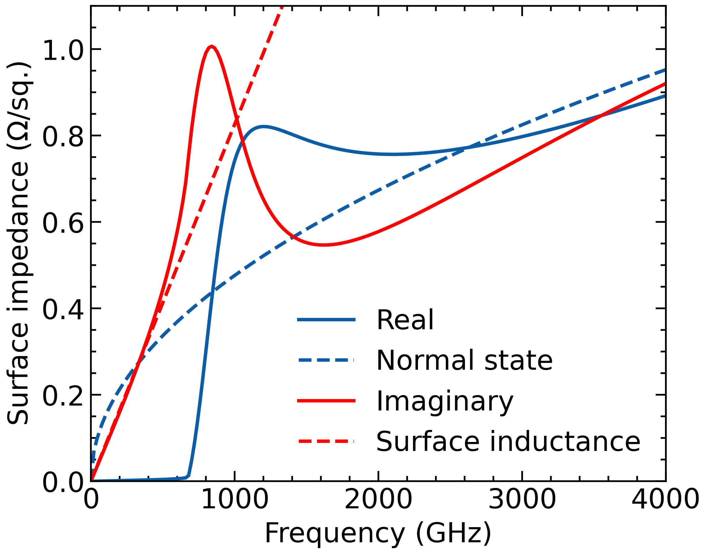

Mattis-Bardeen
==============

[](https://badge.fury.io/py/mattis-bardeen)
[](https://github.com/garrettj403/Mattis-Bardeen/actions/workflows/ci.yml)
[](https://github.com/garrettj403/Mattis-Bardeen/actions/workflows/linter.yml)
[](https://github.com/garrettj403/mattis-bardeen/blob/master/LICENSE)

*Calculate the electrical properties of superconductors using Mattis-Bardeen theory.*

Getting Started
---------------

You can install the Mattis-Bardeen package from [PyPI](https://pypi.org/project/mattis-bardeen/) using ``pip``:

   ```bash
   pip install mattis-bardeen
   ```

Or, to install the latest commit for development:

   ```bash
   git clone https://github.com/garrettj403/Mattis-Bardeen.git
   cd Mattis-Bardeen
   pip install -e ".[dev]"
   ```

Example
-------

Using the package is relatively straight-forward. For example, to calculate the surface impedance of a superconductor:
```python
import mattisbardeen as mb
import numpy as np 
import matplotlib.pyplot as plt 
import scipy.constants as sc

# Properties of the superconducting material, i.e., normal-state conductance,
# critical temperature, gap voltage at T=0K, and penetration depth at T=0K
# (lambda0 is only used by method='simple'; Mattis-Bardeen uses the value
# implied by sigma_n and Vgap0, see mb.penetration_depth)
param = dict(sigma_n=1.74e7, Tc=8.1, Vgap0=2.65e-3, lambda0=86*sc.nano)

# Properties of the specific superconductor
d = 100e-9     # thickness of the superconducting film in [m]
T = 4.         # ambient temperature in [K]
Vgap = 2.8e-3  # gap voltage at temperature T in [V] (optional, see below)

# Frequency in [Hz]
f = np.linspace(0, 1000, 201) * 1e9

# Surface impedance [ohm / sq.]
Zs = mb.surface_impedance(f, d, T, Vgap, **param)

# Plot results
fig, ax = plt.subplots()
ax.plot(f/1e9, Zs.real, label='Real')
ax.plot(f/1e9, Zs.imag, 'r', label='Imaginary')
ax.legend()
ax.set(xlabel='Frequency (GHz)', xlim=[0, 1000])
ax.set(ylabel=r'Surface impedance ($\Omega$/sq.)', ylim=[0, 1.1])
plt.show()

```
<center>

</center>

If the gap voltage at temperature ``T`` is not known, omit ``Vgap`` and it is calculated from ``Vgap0`` and ``Tc`` by solving the BCS gap equation:
```python
Zs = mb.surface_impedance(f, d, T, **param)

# or calculate the gap voltage directly
Vgap = mb.gap_voltage(T, Vgap0=2.65e-3, Tc=8.1)  # 2.516 mV
```

Films of finite thickness, stacks of films and normal metals use a transmission-line model of the film, following SuperMix (Ward et al., 1999; see References), with the displacement current and the impedance behind the film (free space by default):
```python
# Single film, with free space behind it (or e.g. z_back=0 for a perfect conductor)
Zs = mb.surface_impedance(f, d, T, method='film', **param)

# A thin Nb film on 300 nm of gold (normal metal: constant conductivity)
sigma_nb = mb.conductance(f, T, **param)
Zs = mb.film_impedance(f, [(sigma_nb, 20e-9), (1 / 2.2e-8, 300e-9)])

# Above Tc, the normal state
Zs = mb.surface_impedance(f, d, 10., **param)

# Fields on both sides of the film, e.g., a stripline center conductor
Zs = mb.surface_impedance(f, d, T, method='film', excitation='symmetric', **param)

# BCS penetration depth
lam = mb.penetration_depth(T, **param)
```

For planar EM simulators that model a thick conductor as two sheets (e.g., Sonnet em), ``two_sheet_impedance`` gives the modified sheet impedance from Kerr (1996), so that the pair of sheets presents the actual surface impedance:
```python
Zx = mb.two_sheet_impedance(Zs, f, d)
```

References
----------

Mattis-Bardeen theory is described in:

   - D. C. Mattis and J. Bardeen, “Theory of the Anomalous Skin Effect in Normal and Superconducting Metals,” Phys. Rev., vol. 111, no. 2, pp. 412–417, Jul. 1958.

For the purposes of this package, I also referenced the following papers:

   - V. Y. Belitsky and E. L. Kollberg, “Superconductor–insulator–superconductor tunnel strip line: Features and applications,” J. Appl. Phys., vol. 80, no. 8, pp. 4741–4748, Oct. 1996.

   - V. Belitsky, C. Risacher, M. Pantaleev, and V. Vassilev, “Superconducting microstrip line model studies at millimetre and sub-millimetre waves,” Int. J. Infrared Millimeter Waves, vol. 27, no. 6, pp. 809–834, Feb. 2006.
   
   - A. R. Kerr, “Surface Impedance of Superconductors and Normal Conductors in EM Simulators,” Green Bank, West Virginia, 1996.

   - B. Mühlschlegel, “Die thermodynamischen Funktionen des Supraleiters,” Z. Phys., vol. 155, pp. 313–327, 1959.

   - J. P. Turneaure, J. Halbritter, and H. A. Schwettman, “The surface impedance of superconductors and normal conductors: The Mattis-Bardeen theory,” J. Supercond., vol. 4, no. 5, pp. 341–355, Oct. 1991.

   - J. Ward, F. Rice, G. Chattopadhyay, and J. Zmuidzinas, “SuperMix: A flexible software library for high-frequency circuit simulation, including SIS mixers and superconducting elements,” in Proceedings of the Tenth International Symposium on Space Terahertz Technology (ISSTT), Charlottesville, VA, 1999, pp. 268–280.

License
-------

This package is released under the [GNU General Public License](https://github.com/garrettj403/Mattis-Bardeen/blob/master/LICENSE), either version 3 of the License, or (at your option) any later version.
